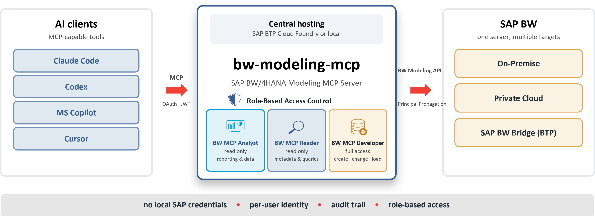

# bw-modeling-mcp

A Model Context Protocol (MCP) server that enables AI assistants like Claude to work directly inside SAP BW/4HANA or SAP BW 7.5 on HANA systems — reading, creating and modifying BW modeling objects via the same internal SAP APIs that Eclipse BWMT and the BW/4HANA Cockpit use: the **BW Modeling REST API** (`/sap/bw/modeling/`) for objects, queries and live data, the **ADT API** (`/sap/bc/adt/`) for the ABAP and AMDP routines BW generates, the **BW/4HANA manage API** for the request monitor and runtime, and the **Push API** (`/sap/bw4/`) for data loads.

**This is not a simulation.** Every tool call connects to a live BW system — write operations produce real changes.

---

## ☁️ Running on SAP BTP Cloud Foundry



Besides stdio, the server can run as an HTTP service on SAP BTP Cloud Foundry with XSUAA
OAuth in front and a BTP destination behind — either a shared technical user
(`BasicAuthentication`) or **principal propagation**, where each caller reaches BW as
themselves and BW applies their own authorizations.

Three role collections decide what a user is offered: **BW MCP Reader** (everything that only reads), **BW MCP Analyst** (a small reporting client — run queries and understand what they return) and **BW MCP Developer** (everything, including changes).
stdio is unchanged — `npm start` behaves exactly as before. Setup:
[docs/CENTRAL-HOSTING-SETUP.md](docs/CENTRAL-HOSTING-SETUP.md) (step-by-step) and
[docs/CLOUD-FOUNDRY.md](docs/CLOUD-FOUNDRY.md) (reference).

### What central hosting changes

| Scenario | stdio only | Hosted on BTP |
|---|---|---|
| **One analyst, one BW system** | runs on the analyst's machine | server-side, the analyst logs in with their own identity |
| **Several analysts, one server** | not possible, no central auth | all log in via BTP, each caller's identity reaches BW |
| **Tool permissions** | none — whoever runs it can call every tool | granted per role, **independent of BW authorizations**: a BW developer can be read-only in the MCP, or the querying tools can be withheld from someone who may otherwise view data |
| **BW authorizations** | enforced through the user's own credentials | unchanged, still fully enforced — with principal propagation each caller acts as themselves, never as a shared identity |
| **Audit trail** | limited | XSUAA logs every login; with principal propagation the BW session log shows the real user |

A new tool stays unavailable to read-only callers until it is explicitly classified as a
read, so the surface never widens by accident; `write` implies `read`, never the reverse.
The three role collections are a starting point and can be split further in `xs-security.json`.
Principal propagation additionally needs a certificate rule and ICM trust on the BW side.

---

## System Compatibility

| System | Support |
|---|---|
| SAP BW/4HANA (all versions) | ✅ Full support |
| SAP BW Bridge (SAP BTP ABAP stack) | ✅ Via cookie authentication (`BW_COOKIE_FILE`) |
| SAP BW on HANA (7.5) | ✅ Modelling reads after a small ABAP enhancement, and modelling **writes** for every object type except the InfoObject — aDSOs, InfoAreas, InfoSources, CompositeProviders, queries and their reusable components, aggregation levels. The tool surface adjusts to what the system publishes, and the objects without a REST resource — including planning, chain runs and the APD — are read from their metadata tables. `bw_system_profile` states per write tool what was verified there. See [BW 7.5 Support](bw75/BW75-SUPPORT.md) |

<p><em><sub>On SAP BW 7.5 the REST framework looks up the <code>Accept</code> header case-sensitively while the kernel delivers header names in lower case, so almost every call fails with HTTP 406. A ~20-line post-exit enhancement (no modification) resolves this and makes all REST endpoints that exist on 7.5 reachable. Objects for which BW 7.5 ships no REST resource at all — transformations, DTPs, process chains and their runs, classic DSOs, InfoCubes, the planning objects and the Analysis Process Designer — are readable through <code>bw_read_metadata_tables</code>, which goes to their metadata tables instead, but they cannot be written; Eclipse opens the embedded SAP GUI for those as well. Details, ABAP code and setup steps: <a href="bw75/BW75-SUPPORT.md">bw75/BW75-SUPPORT.md</a>.</sub></em></p>

---

## 📖 Featured Blog Posts

A two-part blog series about this project (both available in German and English):

1. **Agentic AI meets SAP BW** — the full story behind this project: why I built it, what's inside, what happens when Claude walks through a complete BW data lineage on its own.
   https://www.nextlytics.com/blog/agentic-ai-meets-sap-bw

2. **Agentic AI in practice: MCP server for SAP BW/4HANA** — how the server is operated company-wide on SAP BTP Cloud Foundry with role-based access and per-user identity, plus two real customer projects.
   https://www.nextlytics.com/blog/agentic-ai-in-practice-mcp-server-for-sap-bw/4hana

---

## 🆕 What's New — v1.9.0 · Analysis for Office Workbooks

The workbooks your planners and controllers actually work in are now within reach of the
agent: find them, see what they depend on, take one out of BW, change it, and put it back
into the role menu where users open it.

### On every release (BW/4HANA and BW 7.5)

**📊 Analysis for Office workbooks stored in BW**

- New `bw_list_afo_workbooks` — every workbook stored in BW with its where-used list: data
  sources, planning functions and sequences, BPC models, role menus, last change.
  `used_object` answers the question to ask before touching a query or planning function:
  *which workbooks break if I change this?*
- New `bw_get_afo_workbook` — fetches a workbook exactly as Analysis for Office opens it,
  without taking the edit lock, so nobody working in it is disturbed. BW checks the
  caller's authorization, so under principal propagation everyone gets only what they may open
- New `bw_save_afo_workbook` — saves a workbook back the way Analysis for Office does and
  adds it to a role menu; the where-used list is built from the file itself, so a planning
  function added to the workbook is recorded in BW. Nothing is overwritten without
  `overwrite: true`

Together they close the loop: take a workbook out of BW, change it, and save it back to the
role menu your users open it from.

**🌳 Hierarchy nodes in query structures**

- Structure members can be restricted to hierarchy nodes or a hierarchy node variable, in the
  key figure structure and in the characteristic structure
- `switch_hierarchy` moves every node restriction of a structure to another hierarchy in one
  save, with renamed nodes mapped; unknown hierarchies and nodes are refused before BW stores
  them silently (#50)

### BW/4HANA

**🧮 Agentic Planning, continued**

- New `bw_set_adso_planning_mode` — switches a planning aDSO between planning and loading,
  as the toggle in the BW/4HANA Cockpit does, and checks that the switch took effect
- New `bw_add_process_chain_plswitch` — puts the switch to load mode and back around the
  load of a planning aDSO in a process chain, in one call and without the chain editor
- New `bw_delete_adso_data_selective` — selective deletion by conditions on characteristics;
  simulates first and counts what would go

**🛠️ Fixes and improvements**

- SAP sessions are ended after every tool call instead of piling up in SM04 until users are
  locked out (#48); connections to the backend are reused, so reads answer faster; an
  InfoArea can be moved back to the top level

Thanks to @alxy for #50, and to @army113 and @MWKAnalytics for the analysis behind #48.

---

## What's New — v1.8.0 · Agentic Planning Modelling

An agent can now build a BW planning model end to end — aggregation level, planning
functions, filters and the planning sequence that ties them together — and start the
process chain that runs it.

### BW/4HANA

**🧮 Agentic Planning Modelling**

- New `bw_create_planning_function` / `bw_update_planning_function` — every standard
  function type, each one created and read back: copy, delete, repost, distribution by key
  and by reference data, set values, revaluation, formula (FOX), characteristic
  relationships, currency and unit translation, forecasting
- Characteristic usage, conditions, parameters (constant or variable), key figure and data
  selections in the same call; what the function type may not change is refused before saving
- New `bw_create_planning_filter` / `bw_update_planning_filter` and
  `bw_create_planning_sequence` / `bw_update_planning_sequence`; `bw_delete` removes both
- Deeper reads: `bw_get_planning_filter`, characteristic relationships and data slices in
  `bw_get_planning_properties`, the function type with all its parameters and the block
  characteristics in `bw_get_planning_function`

**💱 Currency translation and unit conversion types**

- New `bw_get_conversion_type` / `bw_create_conversion_type` — currency translation and
  unit conversion types with every option of the BW Modeling Tools: source and target fixed,
  from the record or from a variable; exchange rate type, rate and time reference; unit
  factors from T006, an InfoObject or SI units; `bw_delete` removes them
- Not a planning-only object: a translation type created here serves queries,
  transformation rules and planning functions alike — until now none could be created
  outside the modeling tools

**▶️ Process chains start on request**

- New `bw_start_process_chain` — starts a chain now, in the background; with
  `wait_seconds` it waits for the result, and the log ID leads straight into
  `bw_get_process_chain_run_detail`

**🌳 Hierarchies**

- New `bw_get_hierarchy`, `bw_create_hierarchy`, `bw_update_hierarchy`,
  `bw_delete_hierarchy` — text and value nodes; replacing the tree keeps the hierarchy ID,
  so queries that use it keep working

**🔁 Transformations on a transport**

- `bw_create_transformation` takes a transport request and can activate in the same call (#32)

### On every release (BW/4HANA and BW 7.5)

**📈 Query statistics without SAP GUI**

- New `bw_query_statistics` — executions, users, runtime percentiles and the slowest runs
  broken down by layer, read from the BW statistics; `bw_query_data` with
  `with_statistics` measures its own call (#44)

**🔤 Formula and text variables**

- `bw_create_variable` creates formula variables (dimension, default value, unit or
  currency) and text variables (replacement path or exit); text variables in descriptions
  are bound so they resolve at runtime instead of showing `&NAME&` (#47)

**🔍 Query data that says what happened**

- `bw_query_data` filters hierarchy nodes, keeps interval bounds, says whether more rows
  follow and lists what BW did not apply (#45); `bw_get_query` shows display hierarchies

**🛠️ Fixes**

- A short dump no longer leaves the server unable to lock; amount key figures activate;
  creates work behind a BTP destination and release their lock when they fail; master
  system read from the system (#34); rate limit per client on Cloud Foundry (#35);
  dependency advisories cleared (#40)

Thanks to @MWKAnalytics and @oliverluette for the analyses behind #44, #45 and #47.

---

**Earlier releases** — the "What's New" notes for v1.7.0 and older are archived in [WHATS_NEW.md](WHATS_NEW.md); the full structured history is in [CHANGELOG.md](CHANGELOG.md).

---

## What it can do

An overview by area. Every tool in detail — parameters, behaviour, and the sequences it belongs in — is in the **[Tools Reference](TOOLS.md)** (129 tools).

<p align="center">
  <picture>
    <source media="(prefers-color-scheme: dark)" srcset="https://raw.githubusercontent.com/dnic-dev/bw-modeling-mcp/main/docs/landkarte-dark.svg">
    <source media="(prefers-color-scheme: light)" srcset="https://raw.githubusercontent.com/dnic-dev/bw-modeling-mcp/main/docs/landkarte-light.svg">
    
  </picture>
</p>

---

## Combining with an ADT MCP Server

**bw-modeling-mcp works best alongside an ADT MCP server** such as [vibing-steampunk](https://github.com/oisee/vibing-steampunk) or [ARC-1](https://github.com/arc-mcp/arc-1). The two do not overlap as much as it may look.

This server owns the BW object and, with it, the body of the ABAP that BW generated for that object: the class behind a transformation routine, the program behind a DTP filter routine. Write those through `bw_set_transformation_routine`, `bw_set_transformation_expert_routine` and `bw_set_dtp_filter_routine` rather than through ADT — they do not only replace the source, they save the transformation master back afterwards, which is what re-registers the code in the transportable metadata. A class-only edit survives until the next regeneration or transport and is then gone.

The ADT MCP server covers ABAP as a subject in its own right: your own reports, classes, function modules and DDIC tables, repository search and navigation, arbitrary table reads, debugging, ATC, unit tests, dumps and transports. Together they cover the full cycle from BW object to ABAP logic.

---

## Requirements

- SAP BW/4HANA system with the internal SAP APIs enabled (SAP BW 7.5 works for modeling reads and most modelling writes once the enhancement in [bw75/BW75-SUPPORT.md](bw75/BW75-SUPPORT.md) is in place)
- Node.js 18 or later
- An MCP-compatible AI client (Claude Desktop, Claude Code, etc.)

---

## Installation

> **Two ways to run.** Locally as a **stdio** server (one user, one machine — the steps below), or **centrally hosted** on SAP BTP Cloud Foundry behind XSUAA OAuth for a whole team → see [docs/CENTRAL-HOSTING-SETUP.md](docs/CENTRAL-HOSTING-SETUP.md). The installation and configuration below cover local stdio use; upgrading an existing local setup is non-breaking.

```bash
# Option 1: Install via npm (recommended)
npm install -g bw-modeling-mcp

# Option 2: Clone and build
git clone https://github.com/dnic-dev/bw-modeling-mcp.git
cd bw-modeling-mcp
npm install
npm run build
```

---

## Configuration

For **local (stdio)** use, the server is configured via environment variables. For **central BTP hosting**, connection and credentials come from the BTP destination and service bindings instead — see [docs/CENTRAL-HOSTING-SETUP.md](docs/CENTRAL-HOSTING-SETUP.md).

| Variable | Description | Required |
|---|---|---|
| `BW_URL` | BW system URL (e.g. `https://myhost:50001`) | yes |
| `BW_USER` | SAP user name | yes (or `BW_COOKIE_FILE`) |
| `BW_PASSWORD` | SAP password | yes (or `BW_COOKIE_FILE`) |
| `BW_CLIENT` | SAP client (e.g. `001`) | yes |
| `BW_LANGUAGE` | Language for object texts (e.g. `EN`, `DE`). Default: `DE` | no |
| `BW_COOKIE_FILE` | Path to a browser-exported cookie file for SAML-/OAuth-fronted systems (e.g. BW Bridge). Netscape or `name=value` format. When set, `BW_USER` / `BW_PASSWORD` are optional. | no |
| `BW_MCP_SERVER_NAME` | Server name advertised in the MCP `initialize` handshake. Default: `bw-modeling-mcp`. Give each instance a unique name when running several against different BW systems. | no |
| `BW_MCP_SYSTEM_LABEL` | Free-text label of the connected BW system (e.g. `AP4 (BW production, read-only)`), put at the top of the MCP server instructions. Lets a model tell look-alike instances apart even in clients that show an opaque connector id instead of the server name. | no |
| `BW_PLATFORM` | `auto` (default), `classic` or `bw4`. The server detects whether it is talking to BW/4HANA or a classic release and offers only the tools that release can answer. `classic` forces that verdict when detection cannot run, `bw4` switches the filter off. See [bw75/BW75-SUPPORT.md](bw75/BW75-SUPPORT.md). | no |
| `BW_SESSION_CLOSE` | `on` (default) or `off`. The server ends the SAP sessions of a tool call once it is answered, and all remaining ones when it stops. Set `off` only behind a proxy that holds the SAP session itself. | no |

**Cookie authentication (BW Bridge / SAP BTP):** For BW systems that sit behind a SAML or OAuth login (such as BW Bridge on the SAP BTP ABAP stack), Basic Auth is not available. Export the authenticated session cookies from your browser into a file and point `BW_COOKIE_FILE` at it. The login/session approach is analogous to [vibing-steampunk](https://github.com/oisee/vibing-steampunk) and [ARC-1](https://github.com/arc-mcp/arc-1). When the session expires, refresh the cookie file and restart the server.

### Claude Desktop

Add to `claude_desktop_config.json`:

```json
{
  "mcpServers": {
    "bw-modeling-mcp": {
      "command": "node",
      "args": ["/path/to/bw-modeling-mcp/dist/stdio.js"],
      "env": {
        "BW_URL": "https://your-bw-host:50001",
        "BW_USER": "YOUR_USER",
        "BW_PASSWORD": "YOUR_PASSWORD",
        "BW_CLIENT": "001",
        "BW_LANGUAGE": "EN"
      }
    }
  }
}
```

### Claude Code (VS Code extension)

Add `.mcp.json` to your project root:

```json
{
  "mcpServers": {
    "bw-modeling-mcp": {
      "command": "node",
      "args": ["/path/to/bw-modeling-mcp/dist/stdio.js"],
      "env": {
        "BW_URL": "https://your-bw-host:50001",
        "BW_USER": "YOUR_USER",
        "BW_PASSWORD": "YOUR_PASSWORD",
        "BW_CLIENT": "001",
        "BW_LANGUAGE": "EN"
      }
    }
  }
}
```

---

## How it works

The server talks to four SAP APIs, and only one of them needs a protocol worth describing.

**The BW Modeling REST API** (`/sap/bw/modeling/`) is a full-document API: there is no way to
change one attribute of an object. Every write therefore runs the same six steps.

1. **Lock** — acquires an exclusive lock and returns a `lockHandle`
2. **Read** — fetches the current complete XML of the object
3. **Modify** — applies the change to that XML
4. **PUT** — sends the whole document back, never a fragment
5. **Activate** — promotes the inactive version to the active one
6. **Unlock** — releases the lock

Two consequences are worth knowing. Saving and activating are separate: a document the server
accepts can still fail to activate, so a successful write proves less than it appears to. And
because the whole document travels, a read that came from a stale session buffer will silently
write old values back — the tools read fresh for exactly this reason.

The other three need none of it. The **ADT API** (`/sap/bc/adt/`) is used narrowly and always for
an object BW generated itself: the body of a transformation routine (its generated class), the
body of a DTP filter routine (its generated program), the DataPreview service behind
`bw_read_metadata_tables`, plus transport checks and activation runs. Everything else ABAP —
writing your own reports, classes or DDIC tables, searching the repository, reading arbitrary
tables, debugging — is the job of an ABAP ADT MCP server alongside this one, see
[Combining with an ADT MCP Server](#combining-with-an-adt-mcp-server). The **BW/4HANA manage API** (`/sap/bc/http/sap/bw4/`) answers the request
monitor, the remodeling monitor and runtime operations. The **Push API** (`/sap/bw4/v1/push/`)
takes a JSON record array straight into a write-interface aDSO.

Session cookies and CSRF tokens are handled for all four.

See [ARCHITECTURE.md](ARCHITECTURE.md) for the full technical architecture and the complete
endpoint reference.

---

## Roadmap

- **Focused mode** — an optional, reduced tool surface: a handful of broad tools in place of
  the full set, for clients and models that work better with fewer tools to choose from.

---

## Contributing

Issues and feature requests are welcome — please use the [Issue templates](https://github.com/dnic-dev/bw-modeling-mcp/issues/new/choose).

If you have access to a BW/4HANA system and want to help expand coverage, I am happy to hear from you. The best way to contribute is to try it out and report what works, what doesn't, and what's missing.

---

## License

MIT
