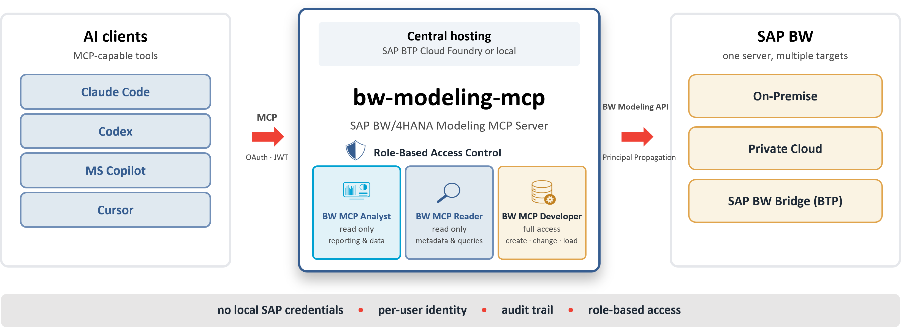
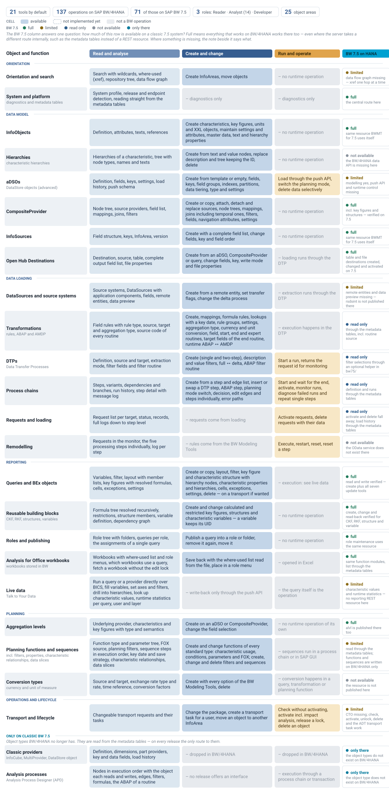

# bw-modeling-mcp

A Model Context Protocol (MCP) server that enables AI assistants like Claude to work directly inside SAP BW/4HANA or SAP BW 7.5 on HANA systems — reading, creating and modifying BW modeling objects via the same internal SAP APIs that Eclipse BWMT and the BW/4HANA Cockpit use: the **BW Modeling REST API** (`/sap/bw/modeling/`) for objects, queries and live data, the **ADT API** (`/sap/bc/adt/`) for the ABAP and AMDP routines BW generates, the **BW/4HANA manage API** for the request monitor and runtime, and the **Push API** (`/sap/bw4/`) for data loads.

**This is not a simulation.** Every tool call connects to a live BW system — write operations produce real changes.

---

## ☁️ Running on SAP BTP Cloud Foundry



Besides stdio, the server can run as an HTTP service on SAP BTP Cloud Foundry with XSUAA
OAuth in front and a BTP destination behind — either a shared technical user
(`BasicAuthentication`) or **principal propagation**, where each caller reaches BW as
themselves and BW applies their own authorizations.

Three role collections decide what a user is offered: **BW MCP Reader** (everything that only reads), **BW MCP Analyst** (a small reporting client — run queries and understand what they return) and **BW MCP Developer** (everything, including changes).
stdio is unchanged — `npm start` behaves exactly as before. Setup:
[docs/CENTRAL-HOSTING-SETUP.md](docs/CENTRAL-HOSTING-SETUP.md) (step-by-step) and
[docs/CLOUD-FOUNDRY.md](docs/CLOUD-FOUNDRY.md) (reference).

### What central hosting changes

| Scenario | stdio only | Hosted on BTP |
|---|---|---|
| **One analyst, one BW system** | runs on the analyst's machine | server-side, the analyst logs in with their own identity |
| **Several analysts, one server** | not possible, no central auth | all log in via BTP, each caller's identity reaches BW |
| **Tool permissions** | none — whoever runs it can call every tool | granted per role, **independent of BW authorizations**: a BW developer can be read-only in the MCP, or the querying tools can be withheld from someone who may otherwise view data |
| **BW authorizations** | enforced through the user's own credentials | unchanged, still fully enforced — with principal propagation each caller acts as themselves, never as a shared identity |
| **Audit trail** | limited | XSUAA logs every login; with principal propagation the BW session log shows the real user |

A new tool stays unavailable to read-only callers until it is explicitly classified as a
read, so the surface never widens by accident; `write` implies `read`, never the reverse.
The three role collections are a starting point and can be split further in `xs-security.json`.
Principal propagation additionally needs a certificate rule and ICM trust on the BW side.

---

## System Compatibility

| System | Support |
|---|---|
| SAP BW/4HANA (all versions) | ✅ Full support |
| SAP BW Bridge (SAP BTP ABAP stack) | ✅ Via cookie authentication (`BW_COOKIE_FILE`) |
| SAP BW on HANA (7.5) | ✅ Modelling reads after a small ABAP enhancement, and modelling **writes** for every object type that has a REST resource there — InfoObjects, aDSOs, InfoAreas, InfoSources, CompositeProviders, Open Hub Destinations, queries and their reusable components, aggregation levels. The tool surface adjusts to what the system publishes, and the objects without a REST resource — including planning, chain runs and the APD — are read from their metadata tables. `bw_system_profile` states per write tool what was verified there. See [BW 7.5 Support](bw75/BW75-SUPPORT.md) |

<p><em><sub>On SAP BW 7.5 the REST framework looks up the <code>Accept</code> header case-sensitively while the kernel delivers header names in lower case, so almost every call fails with HTTP 406. A ~20-line post-exit enhancement (no modification) resolves this and makes all REST endpoints that exist on 7.5 reachable. Objects for which BW 7.5 ships no REST resource at all — transformations, DTPs, process chains and their runs, classic DSOs, InfoCubes, the planning objects and the Analysis Process Designer — are readable through <code>bw_read_metadata_tables</code>, which goes to their metadata tables instead, but they cannot be written; Eclipse opens the embedded SAP GUI for those as well. Details, ABAP code and setup steps: <a href="bw75/BW75-SUPPORT.md">bw75/BW75-SUPPORT.md</a>.</sub></em></p>

---

## 📖 Further Reading

Overview page: **[Agentic AI for SAP BW](https://www.nextlytics.com/en/agentic-ai-for-sap-bw)** — what the server does, use cases and the hosting options.

Three blog posts about this project (all available in German and English):

1. April 2026 · **Agentic AI meets SAP BW** — the full story behind this project: why I built it, what's inside, what happens when Claude walks through a complete BW data lineage on its own.
   https://www.nextlytics.com/blog/agentic-ai-meets-sap-bw

2. July 2026 · **Agentic AI in practice: MCP server for SAP BW/4HANA** — how the server is operated company-wide on SAP BTP Cloud Foundry with role-based access and per-user identity, plus two real customer projects.
   https://www.nextlytics.com/blog/agentic-ai-in-practice-mcp-server-for-sap-bw/4hana

3. November 2026 · **Agentic Planning with Analysis for Office** — a planning model built by an agent in SAP BW, from the aDSO to the planning function, and the workbook that plans on it, built with [afo-mcp](https://github.com/dnic-dev/afo-mcp), the MCP server for Analysis for Office workbooks.
   https://www.nextlytics.com/blog/agentic-planning-analysis-for-office

---

## 🆕 What's New — v2.1.1 · Fixes for Query Texts and Reference Characteristics

A maintenance release on top of v2.1.0, whose highlights follow below. No tool was added
and nothing changes in the configuration.

- **Query edits keep element texts** — editing a query, a reusable structure, a calculated
  or restricted key figure or a variable in a logon language that lacks some of its texts
  no longer marks those elements as having no text. The object is then read and saved in
  its master language, and the result says so (#56)
- **Reference characteristics** — `bw_create_infoobject` with `referenced_infoobject`
  creates the characteristic as a reference; before, it was created on its own (#58)
- **CompositeProviders** — descriptions of fields without an InfoObject are kept, navigation
  attributes work over SAP HANA view inputs and on fields with a unique name, and a mapping
  with an unknown key is refused
- **Why a load failed, on SAP BW 7.5** — the load history of an InfoPackage and a red
  process chain run show the error messages of each red InfoPackage request and the file
  it read (#54)

Details: [CHANGELOG.md](CHANGELOG.md).

## What's New — v2.1.0 · Security Hardening and Deeper Modeling

Two directions again: the server checks more before it acts — the certificate of the BW
system, every tool call, every request it sends — and the modeling tools reach further
into CompositeProviders and transformations.

### Before you update

Most installations need no change. Two points can stop a setup that worked before:

- **The certificate of the BW system is verified.** A system whose certificate comes from an
  in-house certificate authority needs `NODE_EXTRA_CA_CERTS` pointing at a PEM file with that
  authority; a system with a self-signed certificate needs `BW_TLS_VERIFY=off`. Without it
  the connection is refused, and the error names the reason
- **On the hosted server every user signs in again once.** A refresh token issued before the
  update is refused

### 🔒 Security

- **Verified connection to BW** — HTTPS connections check the server certificate, and every
  request is checked before it is sent: it stays on the BW system and on the path it was
  built for, whatever an object name contains
- **Tool calls are validated** — every call is checked against the published schema before
  its handler runs. A call that does not match is answered with the parameters at fault,
  and nothing reaches BW
- **Hardened hosted server** — the endpoint answers only under its own addresses and checks
  where a browser request comes from, refresh tokens belong to the client they were issued
  to, requests are limited per user, and errors leave out the backend address
- **Registration limited to known clients, if you want it** — with
  `BW_OAUTH_REDIRECT_STRICT=on` only the callbacks of known MCP clients and the ones you
  name are accepted. Without it an MCP client of any vendor registers as before, and the
  approval page shows the user where the sign-in returns to
- **Works behind an MCP gateway** — a confidential client may authenticate with
  `client_secret_basic`, and the limits of the OAuth endpoints are configurable, since a
  gateway puts every user behind one address

Details and every setting: [CHANGELOG.md](CHANGELOG.md) and
[docs/CLOUD-FOUNDRY.md](docs/CLOUD-FOUNDRY.md).

### BW/4HANA

**🧩 CompositeProviders, beyond one union or join**

- **Several view nodes** — a CompositeProvider can be built as a tree: a join inside a
  union, a projection or an aggregation above an input or on top (`insert_node`,
  `remove_node`). Every other action works on the node named in `node`
- **Temporal joins** — inputs are joined for the time their records are valid, with the
  validity of a time-dependent characteristic or a validity interval of an aDSO
  (`update_temporal_join`)
- **SAP HANA views as inputs** — a calculation, analytic or attribute view is added as
  `<package>::<view>`, and its mandatory input parameters become parameters of the
  CompositeProvider
- **Replace an input** — another provider takes the place of one input, and mappings,
  constants and join keys follow where the new provider has the fields (`replace_input`)
- **Join operators and node filters** — a join key pair can be compared with an operator
  other than equality, and a view node takes an SQL filter (`update_filter`)
- Fields can be renamed and described, and the currency or unit of a key figure comes
  along when it is mapped

**🔀 Transformations, the settings around the rules**

- **Rule groups** — new `bw_update_transformation_rule_group` adds, renames and removes
  rule groups, and `bw_update_transformation` changes the rule of a field in one group
- **Settings** — new `bw_update_transformation_settings` sets the switches of a
  transformation, per target field the conversion exit and the master data check, the
  grouping of the extraction, and the currency and unit handling
- **Lookups with a key date** — a lookup into time-dependent attributes reads by the date
  of the load, a fixed date or a date from a source field, and a lookup into a DataStore
  object says what happens when nothing is found
- **Conversion behind a formula or a routine** — a currency or unit conversion no longer
  needs a direct assignment
- The record mode rule of an ODP delta can be read and written, and the START routine takes
  its field list

**⛓️ DTPs and process chains**

- **A DTP through any number of transformations** — `bw_create_dtp` takes `trfn_names`, the
  whole path from source to target, and names the object where a path breaks before
  anything is created (#53)
- **A decision inserted into an existing chain** — new `bw_add_process_chain_decision` adds
  the step in place and leaves every other step as it is

### On every release (BW/4HANA and BW 7.5)

- **aDSO structure** — `update_structure` takes secondary indexes, hash partitioning,
  criteria, field groups and changes to plain fields. A renamed field keeps its data on
  BW/4HANA, where the tool writes the rule that carries it over
- **InfoSources** — `bw_update_infosource` changes fields, the key, the field order and the
  two switches of an InfoSource instead of only adding and removing fields

### Also in this release

- **InfoObjects** — the settings of a key figure (aggregation, exception aggregation, data
  type, decimals) and the general settings of a characteristic (data type, length,
  compounding, conversion routine, display) can be changed, a characteristic can be made
  usable as an InfoProvider, and unit and XXL InfoObjects can be created
- Fixed: a process chain and a decision variant are created in the package that was asked
  for instead of as local objects; replacing the tree of a hierarchy no longer ends in a
  server error, and numeric node names are stored in their internal form; a conversion the
  server does not keep is no longer reported as set; `bw_get_infosource` reports the real
  object status; a DTP from a DataSource with a 30-character name passes the path check

---

**Earlier releases** — the "What's New" notes for v2.0.0 and older are archived in [WHATS_NEW.md](WHATS_NEW.md); the full structured history is in [CHANGELOG.md](CHANGELOG.md).

---

## What it can do

An overview by area. Every tool in detail — parameters, behaviour, and the sequences it belongs in — is in the **[Tools Reference](TOOLS.md)** (137 operations behind 21 focused tools).

<p align="center">
  <picture>
    <source media="(prefers-color-scheme: dark)" srcset="https://raw.githubusercontent.com/dnic-dev/bw-modeling-mcp/main/docs/landkarte-dark.svg">
    <source media="(prefers-color-scheme: light)" srcset="https://raw.githubusercontent.com/dnic-dev/bw-modeling-mcp/main/docs/landkarte-light.svg">
    
  </picture>
</p>

---

## Combining with an ADT MCP Server

**bw-modeling-mcp works best alongside an ADT MCP server** such as [vibing-steampunk](https://github.com/oisee/vibing-steampunk) or [ARC-1](https://github.com/arc-mcp/arc-1). The two do not overlap as much as it may look.

This server owns the BW object and, with it, the body of the ABAP that BW generated for that object: the class behind a transformation routine, the program behind a DTP filter routine. Write those through `bw_set_transformation_routine`, `bw_set_transformation_expert_routine` and `bw_set_dtp_filter_routine` rather than through ADT — they do not only replace the source, they save the transformation master back afterwards, which is what re-registers the code in the transportable metadata. A class-only edit survives until the next regeneration or transport and is then gone.

The ADT MCP server covers ABAP as a subject in its own right: your own reports, classes, function modules and DDIC tables, repository search and navigation, arbitrary table reads, debugging, ATC, unit tests, dumps and transports. Together they cover the full cycle from BW object to ABAP logic.

---

## Requirements

- SAP BW/4HANA system with the internal SAP APIs enabled (SAP BW 7.5 works for modeling reads and most modelling writes once the enhancement in [bw75/BW75-SUPPORT.md](bw75/BW75-SUPPORT.md) is in place)
- Node.js 22 or later
- An MCP-compatible AI client (Claude Desktop, Claude Code, etc.)

---

## Installation

> **Two ways to run.** Locally as a **stdio** server (one user, one machine — the steps below), or **centrally hosted** on SAP BTP Cloud Foundry behind XSUAA OAuth for a whole team → see [docs/CENTRAL-HOSTING-SETUP.md](docs/CENTRAL-HOSTING-SETUP.md). The installation and configuration below cover local stdio use. Upgrading from 1.x: see [Upgrading to 2.0](#upgrading-to-20).

```bash
# Option 1: Install via npm (recommended)
npm install -g bw-modeling-mcp

# Option 2: Clone and build
git clone https://github.com/dnic-dev/bw-modeling-mcp.git
cd bw-modeling-mcp
npm install
npm run build
```

---

## Configuration

For **local (stdio)** use, the server is configured via environment variables. For **central BTP hosting**, connection and credentials come from the BTP destination and service bindings instead — see [docs/CENTRAL-HOSTING-SETUP.md](docs/CENTRAL-HOSTING-SETUP.md).

| Variable | Description | Required |
|---|---|---|
| `BW_URL` | BW system URL (e.g. `https://myhost:50001`) | yes |
| `BW_USER` | SAP user name | yes (or `BW_COOKIE_FILE`) |
| `BW_PASSWORD` | SAP password | yes (or `BW_COOKIE_FILE`) |
| `BW_CLIENT` | SAP client (e.g. `001`) | yes |
| `BW_LANGUAGE` | Language for object texts (e.g. `EN`, `DE`). Default: `DE` | no |
| `BW_COOKIE_FILE` | Path to a browser-exported cookie file for SAML-/OAuth-fronted systems (e.g. BW Bridge). Netscape or `name=value` format. When set, `BW_USER` / `BW_PASSWORD` are optional. | no |
| `BW_MCP_SERVER_NAME` | Server name advertised in the MCP `initialize` handshake. Default: `bw-modeling-mcp`. Give each instance a unique name when running several against different BW systems. | no |
| `BW_MCP_SYSTEM_LABEL` | Free-text label of the connected BW system (e.g. `AP4 (BW production, read-only)`), put at the top of the MCP server instructions. Lets a model tell look-alike instances apart even in clients that show an opaque connector id instead of the server name. | no |
| `BW_TOOL_MODE` | `focused` (default) or `full`. The default offers 21 tools: each stands for a group of operations and selects one through its `type` or `operation` parameter, and `bw_describe` gives the complete parameter definition of any operation. `full` offers every operation as a tool of its own (137 on BW/4HANA, three times the tool payload in the model's context) for clients that hold allowlists or scripts on the full tool names. See [Tool modes](TOOLS.md#tool-modes). | no |
| `BW_PLATFORM` | `auto` (default), `classic` or `bw4`. The server detects whether it is talking to BW/4HANA or a classic release and offers only the tools that release can answer. `classic` forces that verdict when detection cannot run, `bw4` switches the filter off. See [bw75/BW75-SUPPORT.md](bw75/BW75-SUPPORT.md). | no |
| `BW_SESSION_CLOSE` | `on` (default) or `off`. The server ends the SAP sessions of a tool call once it is answered, and all remaining ones when it stops. Set `off` only behind a proxy that holds the SAP session itself. | no |
| `BW_TLS_VERIFY` | `on` (default) or `off`. The certificate of the BW system is verified on every HTTPS connection. For a system whose certificate comes from an in-house certificate authority, set the Node.js variable `NODE_EXTRA_CA_CERTS` to a PEM file with that authority and leave this on. `off` switches the check off for a system with a self-signed certificate; the server says so on start. | no |

**Cookie authentication (BW Bridge / SAP BTP):** For BW systems that sit behind a SAML or OAuth login (such as BW Bridge on the SAP BTP ABAP stack), Basic Auth is not available. Export the authenticated session cookies from your browser into a file and point `BW_COOKIE_FILE` at it. The login/session approach is analogous to [vibing-steampunk](https://github.com/oisee/vibing-steampunk) and [ARC-1](https://github.com/arc-mcp/arc-1). When the session expires, refresh the cookie file and restart the server.

### Claude Desktop

Add to `claude_desktop_config.json`:

```json
{
  "mcpServers": {
    "bw-modeling-mcp": {
      "command": "node",
      "args": ["/path/to/bw-modeling-mcp/dist/stdio.js"],
      "env": {
        "BW_URL": "https://your-bw-host:50001",
        "BW_USER": "YOUR_USER",
        "BW_PASSWORD": "YOUR_PASSWORD",
        "BW_CLIENT": "001",
        "BW_LANGUAGE": "EN"
      }
    }
  }
}
```

### Claude Code (VS Code extension)

Add `.mcp.json` to your project root:

```json
{
  "mcpServers": {
    "bw-modeling-mcp": {
      "command": "node",
      "args": ["/path/to/bw-modeling-mcp/dist/stdio.js"],
      "env": {
        "BW_URL": "https://your-bw-host:50001",
        "BW_USER": "YOUR_USER",
        "BW_PASSWORD": "YOUR_PASSWORD",
        "BW_CLIENT": "001",
        "BW_LANGUAGE": "EN"
      }
    }
  }
}
```

---

## How it works

The server talks to four SAP APIs, and only one of them needs a protocol worth describing.

**The BW Modeling REST API** (`/sap/bw/modeling/`) is a full-document API: there is no way to
change one attribute of an object. Every write therefore runs the same six steps.

1. **Lock** — acquires an exclusive lock and returns a `lockHandle`
2. **Read** — fetches the current complete XML of the object
3. **Modify** — applies the change to that XML
4. **PUT** — sends the whole document back, never a fragment
5. **Activate** — promotes the inactive version to the active one
6. **Unlock** — releases the lock

Two consequences are worth knowing. Saving and activating are separate: a document the server
accepts can still fail to activate, so a successful write proves less than it appears to. And
because the whole document travels, a read that came from a stale session buffer will silently
write old values back — the tools read fresh for exactly this reason.

The other three need none of it. The **ADT API** (`/sap/bc/adt/`) is used narrowly and always for
an object BW generated itself: the body of a transformation routine (its generated class), the
body of a DTP filter routine (its generated program), the DataPreview service behind
`bw_read_metadata_tables`, plus transport checks and activation runs. Everything else ABAP —
writing your own reports, classes or DDIC tables, searching the repository, reading arbitrary
tables, debugging — is the job of an ABAP ADT MCP server alongside this one, see
[Combining with an ADT MCP Server](#combining-with-an-adt-mcp-server). The **BW/4HANA manage API** (`/sap/bc/http/sap/bw4/`) answers the request
monitor, the remodeling monitor and runtime operations. The **Push API** (`/sap/bw4/v1/push/`)
takes a JSON record array straight into a write-interface aDSO.

Session cookies and CSRF tokens are handled for all four.

See [ARCHITECTURE.md](ARCHITECTURE.md) for the full technical architecture and the complete
endpoint reference.

---

## Contributing

Issues and feature requests are welcome — please use the [Issue templates](https://github.com/dnic-dev/bw-modeling-mcp/issues/new/choose).

If you have access to a BW/4HANA system and want to help expand coverage, I am happy to hear from you. The best way to contribute is to try it out and report what works, what doesn't, and what's missing.

---

## License

MIT
